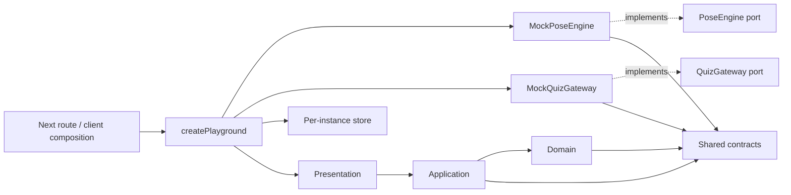
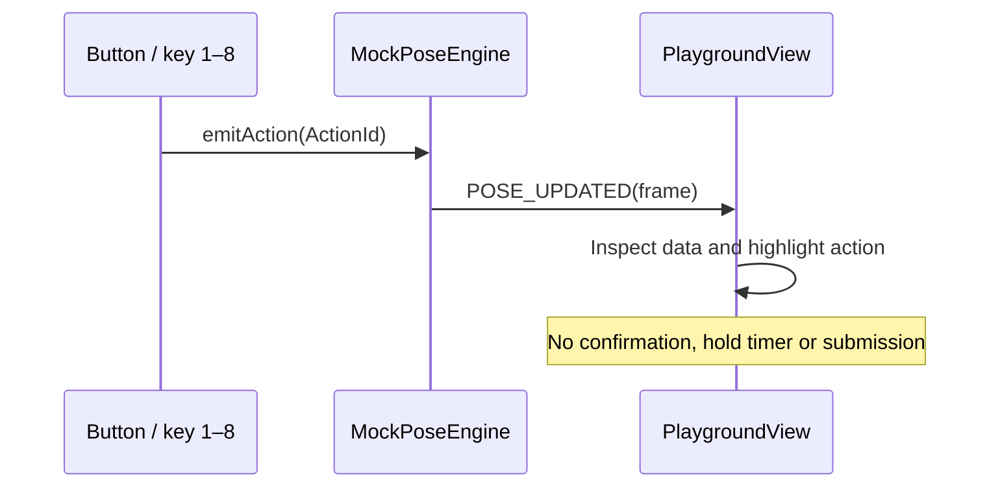
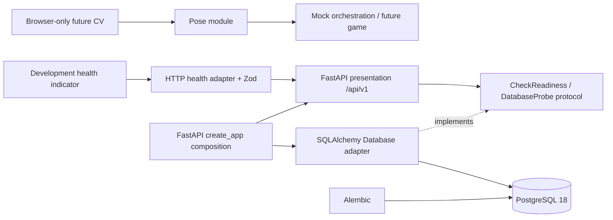

# Architecture

## Why Clean Architecture and feature modules

The game rules must remain independent of React, MediaPipe versions and HTTP.
Feature ownership reduces overlapping edits for three developers. Interfaces are
introduced at actual replaceable boundaries, rather than for every function.
Factory and constructor injection are sufficient; no DI framework is needed. The backend extension follows the same principles below.

## Dependency rules

Domain holds pure concepts/rules without React, DOM, HTTP or JSX. Pose domain can
interpret tracking; game domain validates question/config invariants.
Application defines ports and orchestrates use cases such as loading valid questions.
Infrastructure implements ports and never renders UI. Presentation owns React state
subscriptions and views, never HTTP submission or classification.

Composition is outside the features and may import concrete implementations.
Other cross-feature consumers use public index.ts entrypoints. Inner layers use
local modules and shared contracts, not other feature barrels. Internal code must
not import its own public barrel. This avoids circular dependencies.

An ESLint architecture rule checks import direction, cross-feature deep imports and
framework imports in inner layers. Browser globals are restricted in domain/application.
This is an architectural guardrail, not a formal proof against every dynamic dependency.

## Shared contracts and workspaces

@action-quiz/contracts exports TypeScript source and Zod validation schemas.
Next transpilePackages and Vitest consume source directly, avoiding a separate build
step during parallel development. It is private; publishing would require a compiled
distribution and explicit export strategy. Its tsconfig has ES2022 only, no DOM or
ambient Node types; Zod is its only runtime dependency.

## Composition root and lifecycle

createPlayground(clock) creates a MockPoseEngine, MockQuizGateway, load-questions
use case, per-instance Zustand store and question mapping cache. No mutable singleton.
Fixed mapping is fixture behavior, not a production randomizer. Mapping remains stable
through renders and while revisiting the same question.

PlaygroundClient creates and initializes resources inside a client effect. An active
guard prevents late initialization from mounting UI after unmount. Dispose clears
engine subscribers and prevents further events. StrictMode cleanup/remount is tested.
PlaygroundView removes its keyboard listener and engine subscription on unmount.

A pose event updates inspector state only; game remains READY and hold progress is zero.
Question changes clear the old debug frame and reset game state. Future async frame
and HTTP processing must use session/question generations to discard stale work.

## Experience structure adjustment

Experience currently has only presentation components: CameraViewport accepts an
overlay slot, SkeletonOverlay explicitly marks rendering TODO, HoldProgress presents
an externally supplied value, and ActionInstruction reads metadata. There is no reason
to create empty domain/application/infrastructure folders. Add them when a real rule,
use case or browser adapter needs them. App routes remain thin; composition owns wiring.

## Future adapters and constraints

Huy implements PoseEngine with @mediapipe/tasks-vision. Adapt SDK data at the boundary;
do not expose SDK classes. Initialize/start acquire browser resources client-side;
stop/dispose release camera tracks, RAF callbacks and model resources. Handle permission
failure, unavailable camera, partial landmarks and lost tracking. Mirror only display;
define left/right by the player's anatomical side. Frames are not uploaded or stored by default.

Dũng adds Canvas/audio adapters when used. Keep high-frequency landmarks and drawing
outside broad React/Zustand updates. Measure inference and rendering independently.

Bình adds pure randomization with an injected RNG, continuous hold logic using the
session monotonic clock, candidate resets and one submission per confirmation.
Implement HTTP QuizGateway only after an API specification. Validate unknown DTOs,
send option IDs, handle cancellation/errors/idempotency and keep correct answers server-side.

30 FPS is a future target, not a measured Phase 0 result.

## Reference research

Read the tree, root README, apps/api/README.md, domain game entity, game use case,
apps/web/package.json, lib/api.ts, lib/config.ts and store/game-store.ts in
[DUT-AI/dut-ai-quiz](https://github.com/DUT-AI/dut-ai-quiz).
Adopted monorepo separation, feature grouping, domain contracts and constructor injection.
No source/business logic was copied; auth, DB, Redis and workers were excluded.

The reference API README describes lightweight DDD, while inspected code uses domain
interfaces; decisions here follow inspected code rather than labels alone.
The reference architecture document returned empty content, so it was not treated as evidence.
Its web setup uses Next 14/next lint. This project uses current stable Next and ESLint CLI.
Its API helper triggers UI toast and its store calls HTTP; those concerns are separated
behind gateways here. Runtime validation remains at adapter/use-case boundaries.

Setup was checked against official [Next.js](https://nextjs.org/docs/app/getting-started/installation),
[Tailwind](https://tailwindcss.com/docs/installation/framework-guides/nextjs) and
[Vitest](https://vitest.dev/guide/) documentation.

## Backend and database extension

Python domain remains a documented boundary until actual Quiz rules exist.
No premature tables, CRUD, entities or repository signatures were invented.
Application readiness depends on a pure Protocol, infrastructure implements the
connectivity probe, presentation maps outcomes to Pydantic HTTP responses.
main.create_app wires resources through lifespan and FastAPI dependencies.

Liveness is independent from database readiness. Async engine/session resources are
disposed on shutdown; Alembic is separate from startup. No create_all, auth, worker,
scoring or server-side CV was added. Browser pose contracts remain separate from HTTP DTOs.
Session dependency transaction boundaries and migrations are documented in DATABASE.md.

Additional reference research inspected apps/api/pyproject.toml, main.py, alembic/env.py,
root Compose, Makefile and .env.example. Retained async migration/layering principles,
not SQLModel/Dishka, unrelated routers, Redis, Traefik or workers.
Implementation follows official [FastAPI lifespan](https://fastapi.tiangolo.com/advanced/events/),
[SQLAlchemy async](https://docs.sqlalchemy.org/en/21/orm/extensions/asyncio.html) and
[Alembic asyncio](https://alembic.sqlalchemy.org/en/latest/cookbook.html#using-asyncio-with-alembic)
patterns. The backend uses SQLAlchemy 2.x directly.
