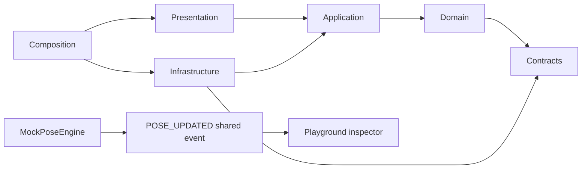

# Phase 0 report

Verification date: 2026-11-04 (Asia/Bangkok). This report covers the original frontend
foundation; the backend/database extension is documented in PHASE_0_BACKEND_DB_REPORT.md.

## 1. Summary

Created npm workspaces, a runnable Next App Router application, a private contracts package,
three owned feature modules, mock ports/adapters, a per-instance composition root,
home/playground UI, quality checks, tests, CI definitions and development documentation.
The extension adds an independent FastAPI/PostgreSQL foundation and optional API health UI.

## 2. Architecture

Clean Architecture within feature modules. Presentation depends on application/domain
contracts; infrastructure implements application ports. Composition wires implementations.
No DI framework, global event bus, application singleton or production CV pipeline.
Experience currently needs presentation components only; empty layers were not manufactured.

## 3. Project structure

```text
apps/web/
  app/{layout,page,globals.css,playground/page}
  composition/{create-playground,playground-client,playground-view}
  features/
    pose/{domain,application/ports,infrastructure/{mock,mediapipe}}
    experience/presentation/components/
    game/{domain,application,infrastructure/{mock,api},presentation/store}
  shared/{components,config,infrastructure}
  tests/
packages/contracts/src/{action,pose,quiz,events,validation,index}
apps/api/                 See backend extension report
docs/
.github/workflows/ci.yml
```

## 4. Key files

| File                                                   | Responsibility                                                             |
| ------------------------------------------------------ | -------------------------------------------------------------------------- |
| package.json / package-lock.json                       | Root workspaces, scripts and exact installed dependency graph              |
| packages/contracts/src/action.ts                       | Eight stable IDs and type-safe metadata                                    |
| packages/contracts/src/validation.ts                   | Runtime pose/question/mapping validation                                   |
| features/pose/application/ports/pose-engine.ts         | Replaceable engine lifecycle/subscription contract                         |
| features/pose/infrastructure/mock/mock-pose-engine.ts  | Manual typed events, lifecycle and cleanup                                 |
| features/game/application/ports/quiz-gateway.ts        | Quiz data/submission boundary using option IDs                             |
| features/game/infrastructure/mock/mock-quiz-gateway.ts | Two four-option fixtures and explicit mock acceptance                      |
| composition/create-playground.ts                       | Clock injection, adapters, load use case, stable fixture mapping and store |
| composition/playground-view.tsx                        | Unified button/keyboard event inspector                                    |
| eslint.config.mjs                                      | TypeScript/React Hooks/Next lint and architecture guardrails               |

Feature paths in this table are relative to apps/web/.

## 5. Dependency flow



Detection only updates debug presentation. It never confirms/submits an answer.
Fixture mapping is fixed and cached by question, not regenerated during renders.
Feature consumers use public entrypoints; composition is allowed concrete adapter imports.

## 6. Verification results

All results below were observed, not inferred.

| Command / check              | Status       | Notes                                                          |
| ---------------------------- | ------------ | -------------------------------------------------------------- |
| npm install                  | PASS         | Workspace dependencies installed and lockfile generated        |
| npm ci                       | PASS         | Final ESLint 10 lockfile installed cleanly                     |
| npm run format:check         | PASS         | Included in final check:all                                    |
| npm run lint                 | PASS         | Both workspaces, with dependency boundaries                    |
| npm run typecheck            | PASS         | Strict web and framework-free contracts                        |
| npm run test                 | PASS         | 12 web tests + 4 contracts tests                               |
| npm run build                | PASS         | Next 16.4.5 production build                                   |
| npm run check:all            | PASS         | Frontend checks/build plus backend checks                      |
| Dev HTTP home/playground     | PASS         | 200; final preview used 3001 because 3000 was occupied         |
| Production home/playground   | PASS         | 200 / 404 respectively                                         |
| Boundary negative checks     | PASS         | Four forbidden imports rejected                                |
| Static baseline import graph | PASS         | No local source cycles                                         |
| npm audit --omit=dev         | PASS         | Zero production dependency advisories                          |
| Hosted GitHub Actions run    | NOT RUN      | Workflow created; no push or remote execution                  |
| Browser visual QA            | NOT VERIFIED | Computer Use could not determine Chrome URL safely and stopped |

RTL tests prove mock events reach presentation through both controls and keyboard;
subscriptions/unmount, lost tracking and StrictMode are covered. React test setup explicitly
enables its act environment and flushes async initialization before sending user input.

## 7. Architecture decisions

Next App Router supplies client/server boundaries and an extensible route structure.
Workspaces avoid extra monorepo orchestration tooling. Shared contracts are an internal API
for the three owners. Constructor/factory injection permits tests without camera/backend.
Zod validates runtime boundaries; Zustand is created per instance and owns UI state only.

Stable package metadata was checked against npm, rather than copied from the reference.
Final versions include Next 16.4.5, React 19.3.1, TypeScript 6.0.3, Tailwind 4.3.4,
Zustand 5.0.16, Zod 4.6.7, Vitest 5.1.0 and ESLint 10.14.0.
TypeScript remains 6.0.x for parser compatibility. Compatible official Next, TypeScript
and React Hooks plugins replace the preset that required older ESLint peer ranges.

The reference repository was read through GitHub without cloning/modifying it.
Research details and inspected paths are in ARCHITECTURE.md.

## 8. Known limitations

No webcam, MediaPipe/model/classifier, real skeleton drawing, audio, production randomizer,
continuous hold/debounce, scoring or Quiz submission API. These are explicit TODOs.
The backend extension exposes operational endpoints only. No FPS/latency benchmark exists.

Final npm install reports 12 moderate advisories in development tooling; production audit
reports zero. No forced major transitive overrides were applied merely to silence audit.
Hosted CI and browser visual QA are not claimed to pass.

## 9. Next steps

Huy: implement the MediaPipe adapter and eight classifiers behind PoseEngine.
Dũng: implement video/Canvas/audio presentation with explicit lifecycle and rendering budgets.
Bình: implement randomizer, hold/state use cases and later QuizGateway HTTP integration;
coordinate backend domain/schema/API design with all contract consumers.

## 10. Ready-for-development checklist

- [x] Root npm workspaces install and run.
- [x] Home and development-only playground serve.
- [x] Eight stable action IDs, complete metadata and typed shared events.
- [x] Three independent owned modules and executable import boundaries.
- [x] MockPoseEngine events reach UI; unsubscribe/dispose work.
- [x] MockQuizGateway returns two valid four-option fixtures.
- [x] Strict types, lint, tests, formatting and production build pass.
- [x] CI definition, env examples, architecture/contracts/workflow/roadmap docs exist.
- [x] Mock mode works without webcam/backend/API URL.
- [x] No out-of-scope production CV or Quiz functionality.
- [ ] Hosted CI execution and browser visual review remain for the team.

Ready for feature development, with the documented verification limits.
